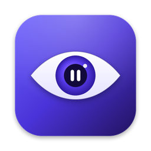
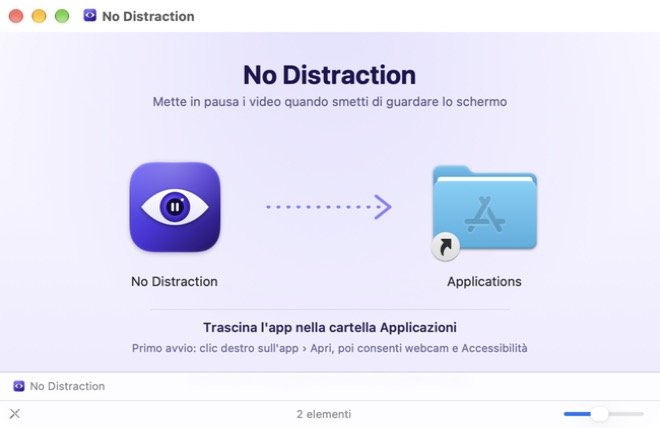

<p align="center">
  
</p>

<h1 align="center">No Distraction Tool</h1>

<p align="center">
  <b>Ti distrai? Il video si ferma. Torni a guardare? Riparte.</b><br>
  <sub>🖥️ App per Mac · 🪟 App per Windows · 🧩 Estensione Chrome · 🔒 Analisi solo in locale</sub>
</p>

<p align="center">
  <a href="https://github.com/andrearicciotti1/nodistractiontool/releases/latest"><b>⬇️ Scarica per Mac (DMG) o Windows (installer)</b></a>
</p>

---

👁️ Strumenti che usano la webcam per capire se stai guardando lo schermo: quando ti distrai **mettono in pausa il video** (con un suono di errore) e lo **fanno ripartire** quando torni a guardare.

🔒 L'analisi avviene **solo sul computer**: nessun fotogramma viene salvato o inviato a un server.

📦 La repo contiene **tre strumenti separati**, indipendenti tra loro:

| | [🖥️ App per Mac](macos/) | [🪟 App per Windows](windows/) | [🧩 Estensione Chrome](chrome-extension/) |
| --- | --- | --- | --- |
| **Cosa mette in pausa** | Qualsiasi programma: Chrome, Safari, Spotify, Musica, QuickTime, VLC, IINA, Elmedia… | Qualsiasi programma nei controlli multimediali di Windows: Chrome, Edge, Firefox, Spotify, VLC… | Solo i video dentro Chrome (YouTube, Netflix, Prime Video, Twitch…) |
| **Dove vive** | Icona nella barra dei menu | Icona nell'area di notifica | Icona dell'estensione in Chrome |
| **Come mette in pausa** | Tasto ⏯ simulato, solo se qualcosa suona | Comandi espliciti Pausa / Play di Windows | Direttamente sui video della pagina |
| **Riconoscimento** | Apple Vision | MediaPipe Face Landmarker | MediaPipe Face Landmarker |
| **Video muti** | Non li ferma | Li ferma, se il programma espone i controlli | Li ferma |
| **Extra** | Apertura al login | Avvio con Windows, installer | Modalità scherzo |
| **Requisiti** | macOS 13+ (consigliato 14.2+) | Windows 10/11 a 64 bit | Chrome 116+ su qualsiasi sistema |
| **Scarica** | [DMG](https://github.com/andrearicciotti1/nodistractiontool/releases/latest) | [Installer](https://github.com/andrearicciotti1/nodistractiontool/releases/latest) | Dalla cartella, in modalità sviluppatore |

🤔 **Quale usare?** Su Mac e Windows l'app copre tutto. L'estensione serve su Linux o ChromeOS, oppure se vuoi solo Chrome. **Non usare app ed estensione insieme**: metterebbero in pausa entrambe.

## ✨ Cosa hanno in comune

- 🎯 **Calibrazione:** all'avvio guardi lo schermo per qualche secondo e la tua posizione diventa quella "neutra".
- 👀 **Quando sei distratto:** volto assente, testa girata o inclinata, occhi chiusi, sguardo di lato o in basso (per esempio verso il telefono).
- ⏱️ **Ritardo** prima della pausa regolabile, così un'occhiata veloce non ferma niente.
- ▶️ **Ripresa** automatica quando torni a guardare (disattivabile): riparte solo ciò che è stato messo in pausa dallo strumento.
- 🔔 **Suono di errore** alla pausa ([`chrome-extension/sounds/error.mp3`](chrome-extension/sounds/error.mp3), usato da entrambi), disattivabile.
- 📷 **Scelta della webcam**, con esclusione automatica di quelle virtuali (OBS ecc.), che senza il programma che le alimenta mandano un'immagine fissa.

## 🖥️ App per Mac — installazione

<p align="center">
  
</p>

**Con il DMG:** ⬇️ scarica [**No-Distraction-1.0.0.dmg**](https://github.com/andrearicciotti1/nodistractiontool/releases/latest) dalle Release, aprilo e trascina l'app in Applicazioni.

**Dal codice:**

```bash
cd macos
./make-dmg.sh          # crea build/No-Distraction-<versione>.dmg
./build.sh --install   # oppure: compila e copia direttamente in /Applications
```

⚠️ L'app non è firmata con un certificato Apple: al primo avvio fai **clic destro sull'app › Apri**. Poi apri **No Distraction** da Applicazioni, consenti la webcam e il permesso **Accessibilità** (serve per premere ⏯ al posto tuo). Dettagli in [`macos/README.md`](macos/README.md).

## 🪟 App per Windows — installazione

1. ⬇️ Scarica [**No-Distraction-Setup**](https://github.com/andrearicciotti1/nodistractiontool/releases/latest) dalle Release e avvialo.
2. ⚠️ Se compare *"Windows ha protetto il PC"*: **Ulteriori informazioni › Esegui comunque** (l'installer non è firmato con un certificato).
3. Segui la procedura (nessun permesso da amministratore); l'app resta nell'area di notifica.

L'installer è compilato e provato automaticamente su Windows da GitHub Actions. Dettagli in [`windows/README.md`](windows/README.md).

## 🧩 Estensione Chrome — installazione

1. Apri `chrome://extensions` e attiva **Modalità sviluppatore**.
2. **Carica estensione non pacchettizzata** → scegli la cartella [`chrome-extension`](chrome-extension/).
3. Icona dell'estensione → **Apri il monitor** → **Avvia monitoraggio** e consenti la webcam (solo la prima volta).
4. Dopo la calibrazione puoi chiudere la scheda: l'analisi continua in background. Da lì in poi si avvia e si ferma dal popup dell'icona.

Dettagli in [`chrome-extension/README.md`](chrome-extension/README.md).

## 🗂️ Struttura

```
nodistractiontool/
├── macos/               App per la barra dei menu (Swift, SwiftUI + AppKit, Apple Vision)
│   ├── Sources/         Codice dell'app
│   ├── Resources/       Info.plist
│   ├── build.sh         Compila e installa
│   └── make-dmg.sh      Crea il DMG di installazione
├── windows/             App per l'area di notifica (Python, MediaPipe, controlli multimediali di Windows)
│   ├── nodistraction/   Codice dell'app
│   └── build/           PyInstaller, Inno Setup e preparazione delle risorse
├── chrome-extension/    Estensione Chrome Manifest V3 (JavaScript, MediaPipe in WebAssembly)
│   ├── icons/           Icone dell'estensione
│   ├── sounds/          Suono di errore (condiviso con l'app)
│   ├── vendor/, models/ MediaPipe e modello del volto
│   └── media/           Clip delle modalità scherzo: NON nella repo, solo in locale
├── branding/            Icona, sfondo del DMG e lo script che li disegna (render.swift)
└── .github/workflows/   Compilazione e prova dell'installer Windows
```

## 📝 Note

- 🎬 I file in `chrome-extension/media/` (clip audio/video delle modalità scherzo) sono di terzi e restano fuori dalla repo.
- 🚗 La "Versione auto" dell'estensione è un prototipo dimostrativo non certificato: non usarla come sistema di sicurezza alla guida.
